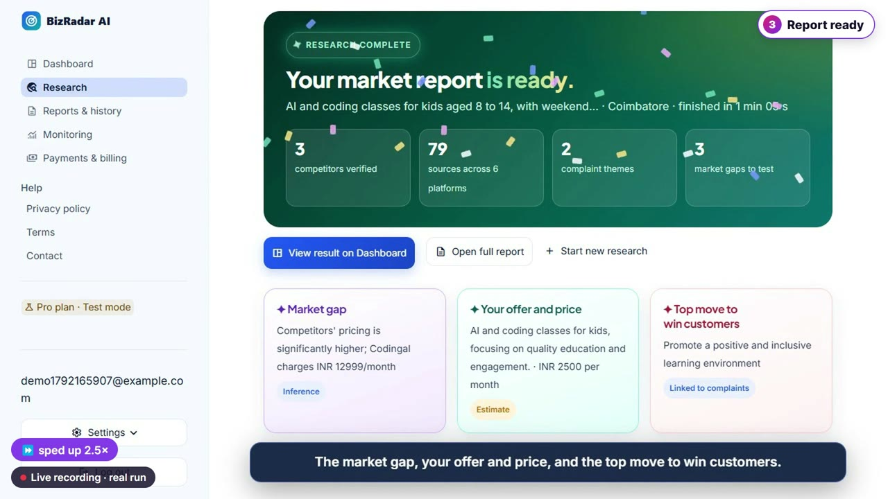
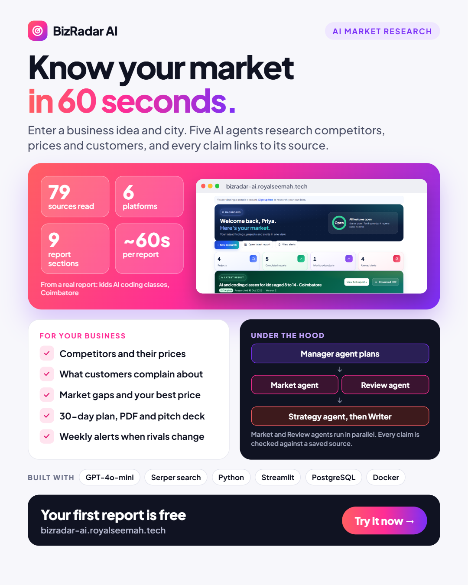

# BizRadar AI

**Know your market in about a minute.** Enter a business idea, a city and a target customer. Five AI agents research the live web and return a sourced market report: competitors and their prices, what customers complain about, market gaps, positioning and a 30-day launch plan.

## 🎥 Demo

[▶ Watch the demo video](demo/bizradar-ai-demo.mp4), 2 min 57 s. It is built from real research runs recorded in the running app, with narration.

## The business problem

Before a new business launches, someone has to study the competition. Usually a marketing intern spends **2 to 3 days** searching websites, maps and reviews and copying everything into Excel. The result has no sources and goes out of date quickly.

## The solution

- **Five AI agents.** A Manager plans the work. A Market Researcher and a Review Analyst run in parallel, then a Strategy Analyst and a Report Writer follow.
- **Proof for every claim.** Each price and claim links to the page it came from, with the date. Anything without a saved source is removed before the report is built.
- **Honest labels.** Claims are marked Fact, Estimate, Inference or Unknown. Missing data is shown as missing, never invented.
- **Built for India.** It searches Google, Google Maps, Justdial, Sulekha, IndiaMART, magicpin, Swiggy, Zomato, Instagram, Facebook, YouTube, Reddit, Quora, Trustpilot and MouthShut, and reports prices in ₹.
- **Never overspends.** Every run has hard limits on AI tokens, pages, searches and time.
- **Outputs.** A 9-section report on screen, Markdown and PDF downloads, a pitch deck, and weekly monitoring alerts when a rival changes.

## Real research runs shown in the demo

| Business idea · city | Sources | Platforms | Time |
|---|---|---|---|
| Kids AI coding classes · Coimbatore | 79 | 6 | 1 min 05 s |
| Organic vegetable box · Mysuru | 86 | 5 | 58 s |
| Coworking café for students · Kochi | 70 | 6 | |

The Coimbatore run used 13 searches and about 15k tokens, and found 3 competitors, 2 complaint themes and 3 market gaps.

## How it works

`Idea + city → input checks and plan limits → job saved in PostgreSQL → background worker → Manager → Market Researcher + Review Analyst (parallel) → Strategy Analyst → Report Writer + validation gate → report snapshot → screen, PDF, Markdown, pitch deck`

📄 [Technical guide (PDF)](docs/TECHNICAL_GUIDE.pdf): agents, data flow, safety limits and validation.

## Business value

- Market research that took days now takes about a minute
- Every price and claim can be verified at its source
- Weekly monitoring keeps the picture current

**Who it is for:** first-time founders testing an idea, small business owners watching rivals, and consultants and agencies who need client-ready reports with sources.

**Stack:** Python · Streamlit · PostgreSQL · Redis background worker · Docker · GPT-4o-mini · Serper search

*BizRadar AI is in private testing. Source code is private; a walkthrough is available on request.*
