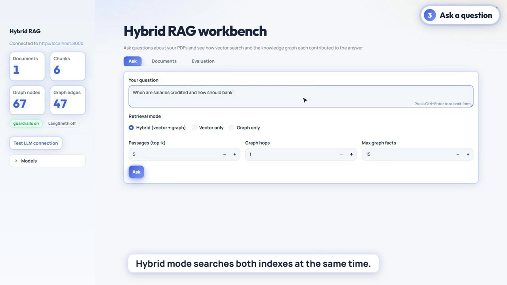

# Hybrid RAG: FAISS + Knowledge Graph

**Ask questions about your documents and see exactly how each answer was built.** Every PDF is indexed twice: as vectors (FAISS) and as a knowledge graph (NetworkX). Both are searched for every question, and the answer is checked by guardrails, scored by DeepEval and traced in LangSmith.

## 🎥 Demo

[▶ Watch the demo video](demo/hybrid-rag-demo.mp4), 1 min 50 s. It is a real recording of the running application, with narration.

## The business problem

Teams need answers from policies, contracts and manuals, but plain chatbots can invent facts and give no way to check them. For business use, every answer must be traceable to the source text.

## The solution

- **Two retrievers, one answer.** Semantic vector search plus a knowledge graph of facts extracted from the documents.
- **Cited answers.** Every answer shows its passages, graph facts, scores and timings.
- **Guardrails.** NVIDIA NeMo Guardrails check the question before retrieval and the answer after generation, including a grounding check against the evidence.
- **Measured quality.** A built-in DeepEval evaluation reports faithfulness, answer relevancy, contextual precision and contextual recall.

## How it works

`PDF → chunks → embeddings (FAISS) + LLM-extracted facts (NetworkX graph) → question → input guardrail → vector search + graph search → fused context → LLM answer → output guardrail → answer with all evidence`

## Results

- Hybrid, vector-only and graph-only modes can be compared side by side.
- **77 automated tests** cover the pipeline.
- Each evaluation score is linked to the LangSmith trace of the answer it measures.

**Stack:** Python · FastAPI · Streamlit · FAISS · sentence-transformers · NetworkX · OpenAI or Anthropic Claude · NVIDIA NeMo Guardrails · DeepEval · LangSmith · Docker

**Source code:** [github.com/Seema777111-git/RAG/tree/main/rag-hybrid](https://github.com/Seema777111-git/RAG/tree/main/rag-hybrid)
