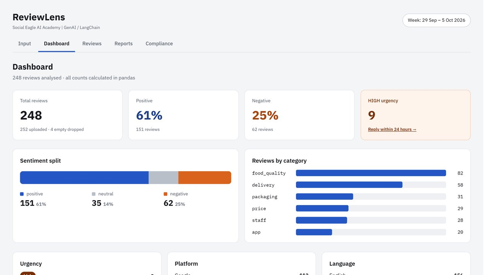
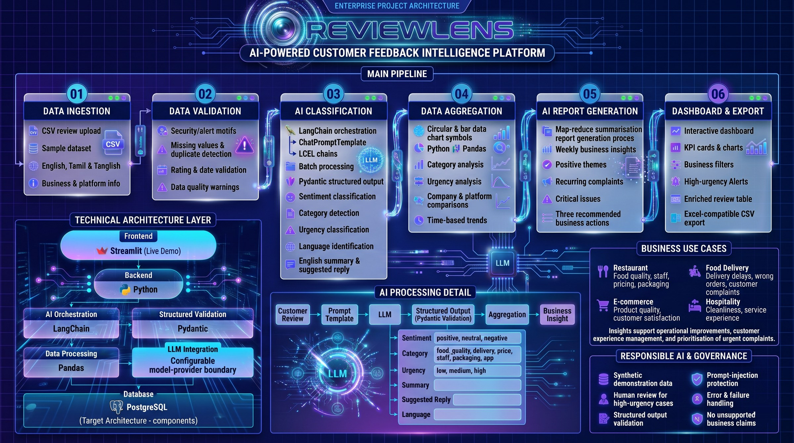

# ReviewLens

**Turn customer reviews into clear, actionable insights in seconds.** Upload reviews as a CSV and ReviewLens reads every one. It tags sentiment, category and urgency, then shows the top pros and cons, critical issues and a weekly insights report on one dashboard.

## 🎥 Demo

- [▶ Watch the demo video](demo/reviewlens-demo.mp4)
- [Source code](https://github.com/Seema777111-git/ReviewLens)

## The business problem

Popular products and businesses collect thousands of reviews, and nobody has time to read them all. Important feedback stays hidden in long, messy text, and star ratings alone don't explain why customers are happy or unhappy.

## The solution

- **Every review tagged** with sentiment, category, urgency and language.
- **Validated AI output** using LangChain with Pydantic structured responses.
- **Weekly insights report** with positive themes, recurring complaints, critical issues and three recommended actions.
- **High-urgency alerts**, plus a suggested reply for each review.
- **English, Tamil and Tanglish** reviews supported.

## How it works

## Technology

Python · Streamlit · LangChain · Pydantic · Pandas · LLM integration

> All demo companies and reviews are synthetic data, so no real customer information is used.
