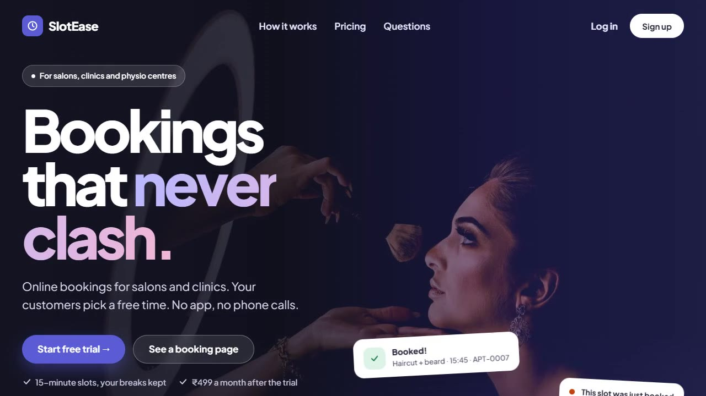
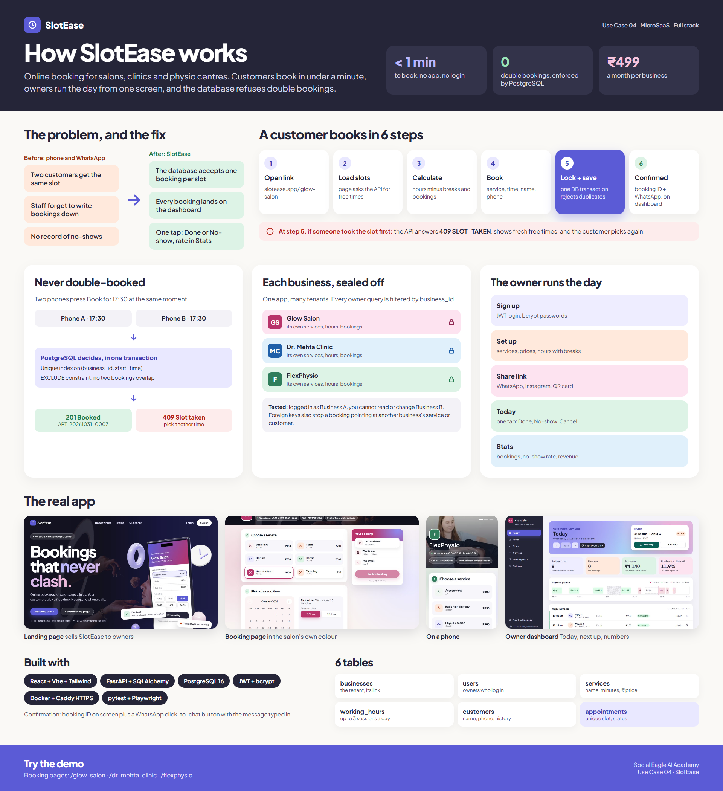

# SlotEase

**Online booking for salons, clinics and physiotherapy centres.** Customers book a free slot in under a minute, with no app and no login. Owners run the day from one screen, and the database refuses double bookings.

## 🎥 Demo videos

- [▶ Landing page](demo/SlotEase-1-landing.mp4): how SlotEase is presented to business owners
- [▶ Owner dashboard](demo/SlotEase-2-dashboard.mp4): today's schedule, week view, stats, services and settings
- [▶ Customer bookings](demo/SlotEase-3-bookings.mp4): booking at three different businesses

## 📊 Infographic

## The business problem

Small appointment-based businesses take bookings by phone and WhatsApp. Two customers get the same slot, staff forget to record bookings, and there is no record of no-shows.

## The solution

- **A booking page per business** in its own colours, shared on WhatsApp, Instagram or a QR code.
- **No double bookings.** PostgreSQL decides in one transaction; a second request for the same slot is refused and shown fresh free times.
- **Owner dashboard.** Today's bookings, next customer, one-tap Done or No-show, weekly view and monthly stats (bookings, no-show rate, estimated revenue).
- **Working hours with breaks.** Up to three sessions per day, with clinic and salon presets.
- **Multi-tenant and isolated.** Every business only sees its own data, which is tested.

## Quality

| Measure | Result |
|---|---|
| Backend tests | 206 |
| End-to-end tests (Playwright) | 38 |
| Accessibility (WCAG 2.1 AA, axe) | 0 serious or critical issues on all 11 screens |
| Lighthouse, home page (desktop) | Performance 97 · Accessibility 100 · Best practices 100 |

## Business model

One plan: **₹499 per month per business**, after a free trial.

**Stack:** React · TypeScript · Vite · Tailwind · FastAPI · SQLAlchemy · PostgreSQL 16 · JWT + bcrypt · Docker · Caddy (HTTPS) · pytest · Playwright

*Source code is private; a walkthrough is available on request. All businesses and customers shown are demo data.*
