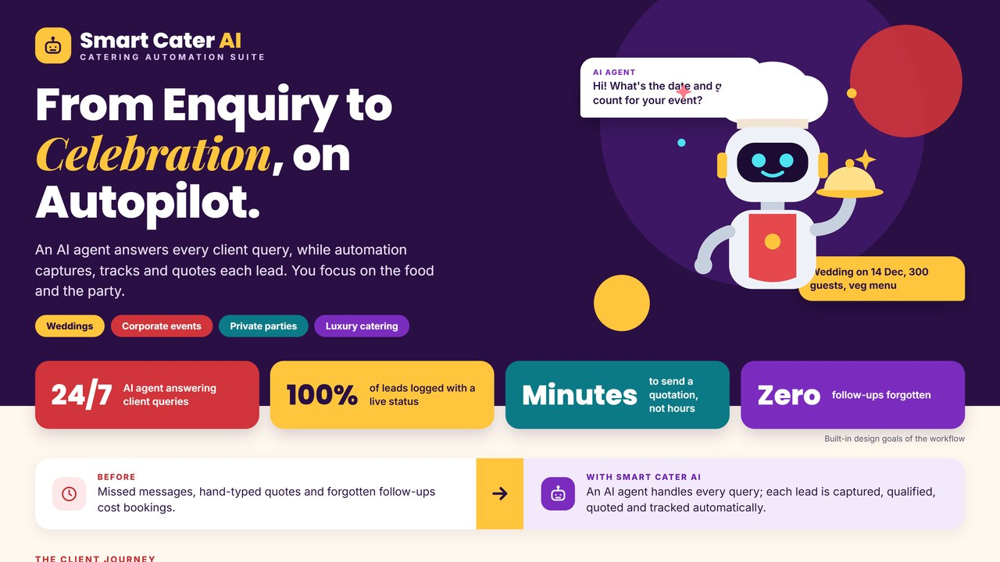
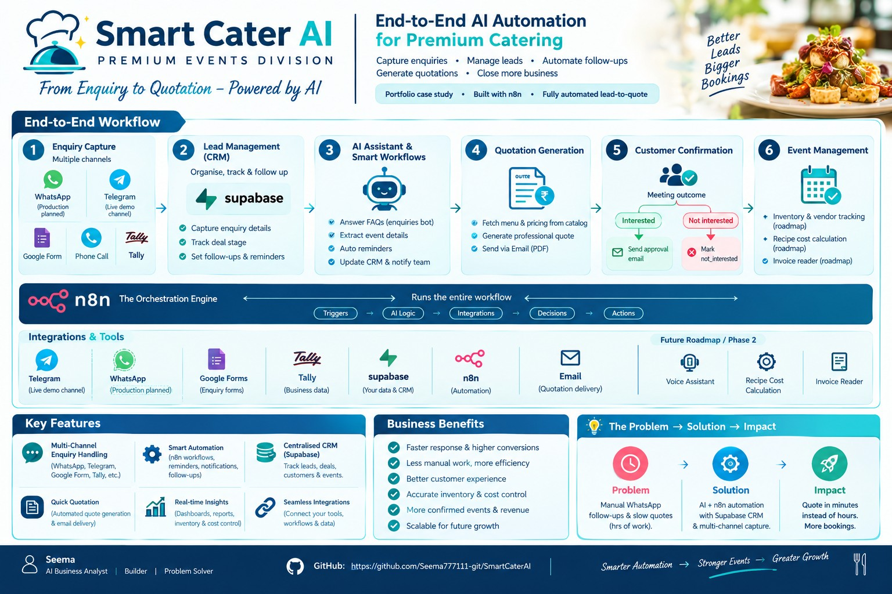

# Smart Cater AI

**From enquiry to quotation, on autopilot.** An AI agent answers a catering client's questions in chat and collects the event details. Automation then records the lead, books a consultation, sends an approval request and emails a professional quotation, with no manual chasing.

## 🎥 Demo

[▶ Watch the demo video](demo/smart-cater-ai-demo.mp4), 1 min 34 s. It follows one real enquiry from the first chat message to the quotation PDF in the client's inbox.

## The business problem

Caterers for weddings, corporate events and private parties receive enquiries on WhatsApp, Telegram, phone and forms. Messages are missed, quotations are typed by hand, and follow-ups are forgotten, so bookings are lost to faster competitors.

## The solution

- **AI chat agent.** Clients chat on Telegram (WhatsApp ready). The agent answers questions and collects the event type, date, guests, venue, food preference and budget, then confirms the details with the client.
- **One lead database.** Every enquiry, from chat or a Tally form, lands in Supabase with a clear stage, so there are no spreadsheets.
- **Instant follow-up.** The client gets a confirmation email and a calendar invitation for a consultation.
- **Human approval.** The owner receives a quotation approval email with the enquiry summary and approves with one click.
- **Automatic quotation.** An itemised quotation PDF (food, service charge, GST and total) is generated and emailed to the client.
- **Clean pipeline.** Interested leads move forward; leads that are not interested are closed politely and marked.

## How it works

`Chat or form enquiry → AI agent collects details → lead saved in Supabase → confirmation email + calendar invite → approval email to owner → quotation PDF → emailed to client → stage updated`

A fuller visual summary: [lead-to-quote overview](SmartCater-AI-lead-to-quote.jpg).

## Business value

- Every enquiry answered, 24 hours a day
- Quotations sent in minutes instead of hours
- 100% of leads logged with a live status, and no follow-up forgotten
- The owner stays in control of every price that goes out

**Who it is for:** caterers, event planners, banquet halls and any service business that quotes per enquiry.

**Stack:** n8n · Google Gemini AI agent · Telegram · WhatsApp (WAHA / Meta Cloud API) · Tally forms · Supabase (PostgreSQL) · Gmail · Google Calendar · PDF generation

*Source workflows are private; a walkthrough is available on request.*
