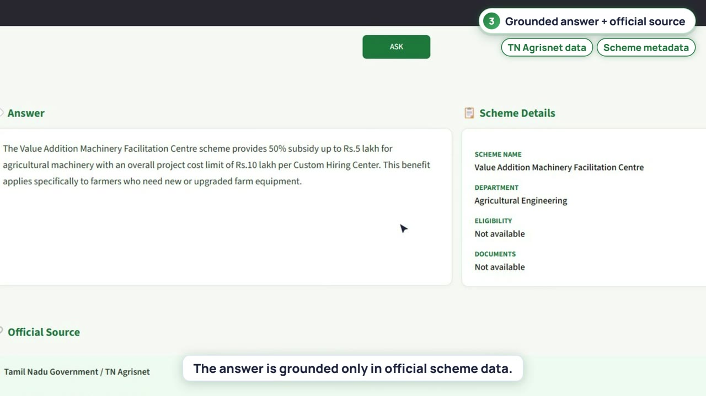

# TN Farmer Scheme AI Assistant

**Helps Tamil Nadu farmers find the government schemes they qualify for, asked in English, Tamil or Tanglish, with answers taken only from official scheme data.**

## 🎥 Demo

[▶ Watch the demo video](https://github.com/Seema777111-git/RAG/blob/main/TN_FARMER_SCHEME_AI/demo/tn-farmer-scheme-ai-demo.mp4), 2 min 23 s. It is a real recording of the running app, with narration.

## The problem

Scheme information is spread across government pages written in official language, mostly in English. Many farmers never learn about subsidies that exist for them, or which documents they need.

## The solution

- **Multilingual questions.** English, Tamil and Tanglish are all understood.
- **Official data only.** Schemes are collected from the TN Agrisnet government portal, and every answer cites its source scheme.
- **Hybrid retrieval.** Dense vector search (BGE + FAISS) and keyword search (BM25) are fused with reciprocal rank fusion, then reranked by a cross-encoder.
- **Guardrails.** Off-topic or unclear questions are refused, with no call to the language model.
- **Runs locally.** Answers are generated by Qwen 2.5 through Ollama.

## Results shown in the demo

| Measure | Result |
|---|---|
| Official schemes indexed | 32 |
| Indexed chunks | 63 |
| Labelled evaluation questions passed (English, Tamil, Tanglish) | 10 / 10 |

## Social value

It makes public welfare information accessible in the user's own language, with sources the user can verify.

**Stack:** Python · Streamlit · BGE embeddings · FAISS · BM25 · CrossEncoder reranker · Qwen 2.5 (Ollama)

**Source code:** [github.com/Seema777111-git/RAG/tree/main/TN_FARMER_SCHEME_AI](https://github.com/Seema777111-git/RAG/tree/main/TN_FARMER_SCHEME_AI)
