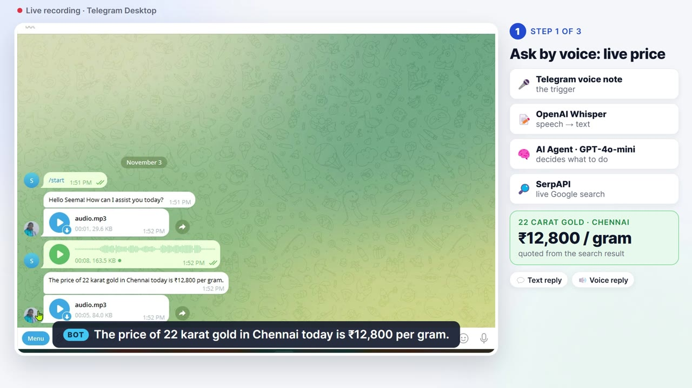
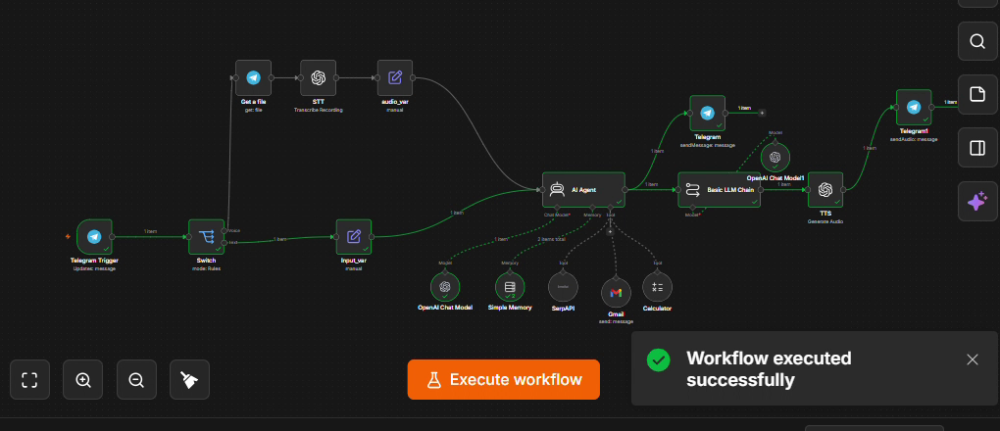

# Voice AI Agent

**A Telegram assistant that customers can talk to. It listens, finds live information, does the calculation, sends the email, and replies in text and voice.**

## 🎥 Demo

[▶ Watch the demo video](demo/voice-ai-agent-demo.mp4), 2 min 52 s. It is a real recording of the bot in Telegram Desktop, with narration.

## The business problem

Customers increasingly prefer to send a voice note instead of typing. Small businesses such as jewellers, clinics and agents receive the same questions all day, often after hours, and cannot answer every message quickly.

## The solution

A voice-first AI assistant on Telegram, built as a single n8n workflow:

- **Understands voice and text.** Voice notes are transcribed with OpenAI Whisper.
- **Uses live data.** It searches Google through SerpAPI for current prices and rates.
- **Calculates correctly.** Totals come from a calculator tool, not from the language model.
- **Takes action.** It writes and sends emails through Gmail, for example a price quote.
- **Replies twice.** It sends the full answer as text, plus a short spoken summary generated with OpenAI text-to-speech.

## Verified results from the recorded demo

| Request (spoken) | Outcome |
|---|---|
| Price of 22 carat gold in Chennai today | ₹12,800 per gram, quoted from the search result |
| Cost of 10 grams including GST | ₹1,31,840 (12,800 × 10 × 1.03), from the calculator tool |
| "Send this to my email" | Email delivered to the inbox at 2:02 PM; Gmail returned status SENT |

## How it works

`Telegram → Switch (voice / text) → Whisper → AI Agent (GPT-4o-mini + memory + SerpAPI, Calculator, Gmail) → text reply + speech summary → OpenAI TTS → voice reply`

## Reliability safeguards

- The agent may only quote a number that appears in the search results. If none is found, it says so instead of estimating.
- The agent must not report an email as sent unless the Gmail tool confirms it.
- Replies are escaped so special characters cannot break message delivery.

## Business value

- Answers customers 24 hours a day, in the way they already communicate.
- Removes repetitive enquiries from staff.
- Moves beyond chat to action: quotes and summaries by email.

**Possible extensions:** the client's own price list or API, WhatsApp channel, lead logging to Google Sheets or a CRM, appointment booking, and Tamil or Hindi replies.

**Stack:** n8n (self-hosted in Docker) · Telegram Bot API · OpenAI Whisper · GPT-4o-mini · SerpAPI · Gmail · OpenAI TTS

*The workflow is available for a walkthrough on request.*
